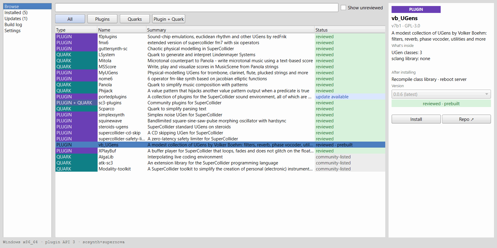
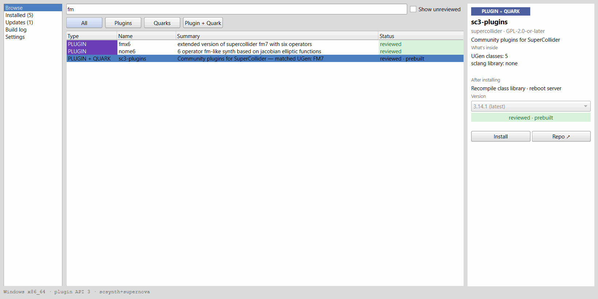
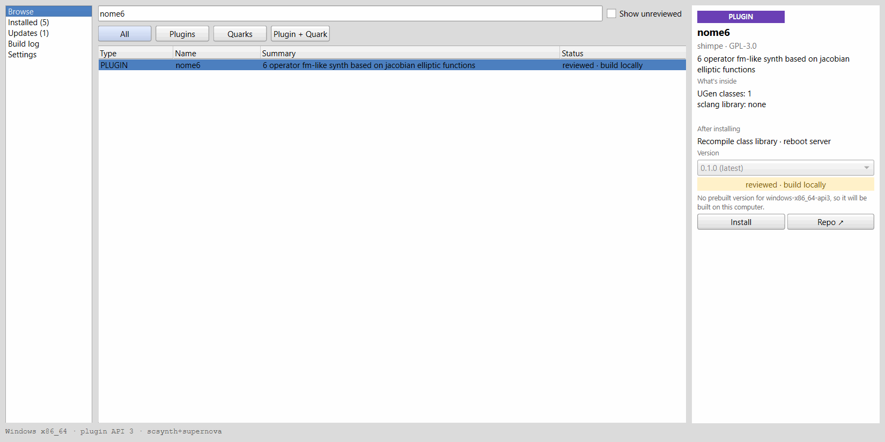
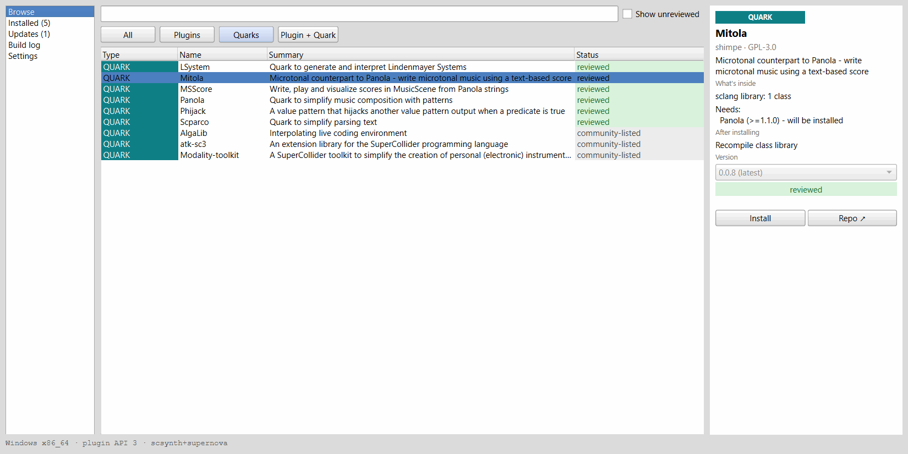
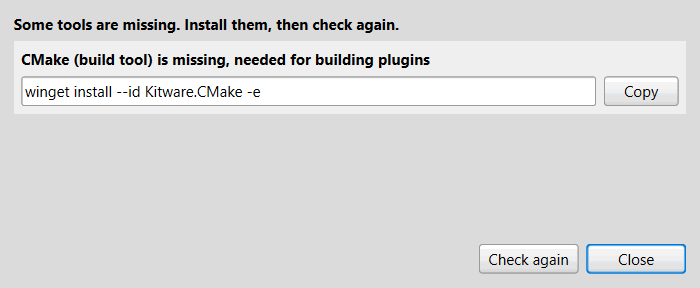
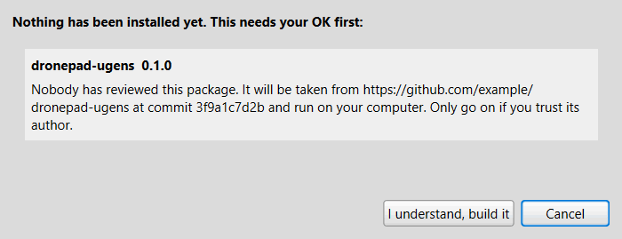
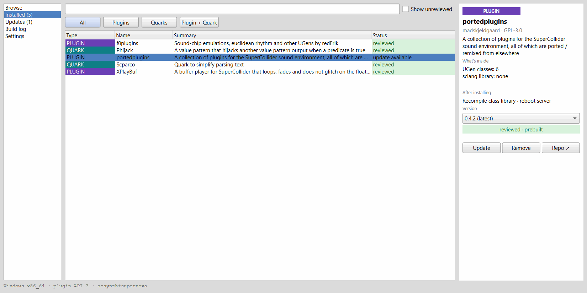

# sc-deken

Find, install, update and remove SuperCollider plugins and quarks from one window
inside SuperCollider.

SuperCollider plugins (UGens) are usually source code on GitHub. To use one you
normally need a compiler, CMake and the right SuperCollider headers. Quarks have
their own installer. sc-deken puts both in one place: a searchable list of
packages, prebuilt and signed downloads where they exist, and a build on your own
computer (with a clear list of what is missing) where they do not.



## Install

In SuperCollider, run these two lines, then open the window:

```supercollider
Quarks.install("https://github.com/shimpe/scdeken"); thisProcess.recompile;

// after the class library has recompiled:
Deken.gui;
```

The first time you use it, Deken downloads a small helper program (`scdeken`)
and checks it against a checksum that ships with the quark. SuperCollider 3.13
or newer is needed. Windows, macOS and Linux are supported.

Status: the first public release is being prepared. Until the signed package list
and the first helper release are published (see the
[maintainer guide](docs/maintainer-guide.md)), the window cannot fill itself from
the internet. The screenshots below use a made-up but realistic package list.

## A quick tour

**Search by name, summary or UGen name.** Every row shows what the package is
(`PLUGIN`, `QUARK` or `PLUGIN + QUARK`), a one-line summary and a status badge.
Packages found only by a UGen or class name say so ("matched UGen: FM7").



**See what you get before you install.** The details pane lists what is inside,
what has to be done afterwards (recompile, reboot the server), which version you
get, and how it will be installed: a prebuilt download or a build on this
computer.



**Quarks that need other quarks bring them along.**



**Missing build tools are named, with the command to install them.**



**Unreviewed packages are marked and need your explicit OK.** They are hidden until
you tick "Show unreviewed", and the confirmation names the repository and the exact
commit that would be built.



**Installed packages, updates and the build log.**



**Withdrawn packages are flagged.** If maintainers withdraw a package or version
(malware, a serious vulnerability, or a dangerous bug), sc-deken tells you when you
have it installed. Nothing is removed without your permission, and removal moves the
package to a quarantine folder instead of deleting it.


More pictures and every step in plain words: [docs/user-guide.md](docs/user-guide.md).

## How it stays trustworthy

- Packages enter the list as **recipes** (plain data) reviewed by maintainers.
  Every reviewed version is pinned to a git commit a maintainer approved.
- Prebuilt downloads are built by CI from those recipes, never uploaded by
  individuals. The package list is **signed**; `scdeken` refuses a list whose
  signature fails and a download whose checksum does not match.
- Unreviewed packages carry no downloads. You can build them locally, after a
  warning that names the repository and the commit.
- Nothing you own is deleted without asking: replaced copies go to a backup
  folder and withdrawn packages go to quarantine.

## From sclang

Everything the window does is also available as code. Calls return at once and the
answer arrives later.

```supercollider
Deken.search("fm");                 // posts the hits
Deken.install(\Panola);             // a quark
Deken.install(\portedplugins);      // a plugin (prebuilt, or built here)
Deken.update(\portedplugins);
Deken.remove(\portedplugins);
```

See the help pages `Deken`, `DekenGui` and the guide `Deken-Guide` (open the
SuperCollider help and search for "Deken").

## Command line (for maintainers and scripts)

The helper is a normal program. The most useful commands:

```text
scdeken search <query> [--include-unreviewed]   find packages
scdeken info <package>                          versions, trust, withdrawn versions
scdeken doctor [<package>]                      are the build tools there?
scdeken install <package>[@version]             install (add --yes-unreviewed etc. when asked)
scdeken recipe new <github-url> [--out <file>]  draft a recipe for a repository
scdeken recipe check <file> [--build]           validate a recipe, optionally build it
scdeken recipe approve <file> <version> <commit>
scdeken build --recipe <file> --version <v> --out <folder>
scdeken index build | sign | keygen             (maintainers) make and sign the package list
scdeken advisories validate --dir <folder>      check advisory files
```

Output is JSON; exit codes are 0 ok, 1 error, 2 usage, 3 needs your confirmation.
Run `scdeken` without arguments for the full list. The maintainer side (recipes,
approvals, advisories, signing, releases) is described in
[docs/maintainer-guide.md](docs/maintainer-guide.md).

## Documentation

- [User guide](docs/user-guide.md): installing sc-deken, finding, installing,
  updating and removing packages, local builds, withdrawn packages, troubleshooting.
- [Maintainer guide](docs/maintainer-guide.md): adding packages, approving versions,
  advisories, signing key, releases, CI.
- [Design](docs/superpowers/specs/2026-10-24-sc-deken-design.md): why it works the way it does.
- The package recipes live in [shimpe/scdeken-recipes](https://github.com/shimpe/scdeken-recipes).
  The package list is published at
  <https://shimpe.github.io/scdeken-recipes/index.json>.

## Building from source

You need Go 1.23 or newer. There are no dependencies to install beyond what
`go.mod` lists.

```text
go build -o scdeken ./cmd/scdeken      # the helper
go vet ./... && go test ./...          # Go tests
```

The sclang tests run in a throwaway SuperCollider profile that never touches your
own settings, quarks or extensions (Git Bash on Windows, or any POSIX shell):

```text
scripts/run-sclang-tests.sh            # all UnitTests under classes/tests
```

To use a helper you built yourself instead of the downloaded one, set
`Deken.helperPath = "/path/to/scdeken";` before opening the window.

The screenshots in `docs/screenshots` are produced by a script against a made-up
but realistic package list; see `scripts/gui-screenshots.scd`:

```text
SCDEKEN_SCRIPT=$PWD/scripts/gui-screenshots.scd scripts/run-sclang-tests.sh
scripts/optimize-screenshots.sh
```

## License

MIT, copyright (c) 2026 Stefaan Himpe. See [LICENSE](LICENSE). Packages you install keep
their own licenses.
