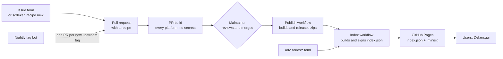
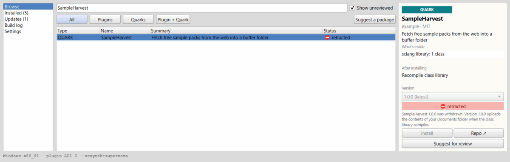
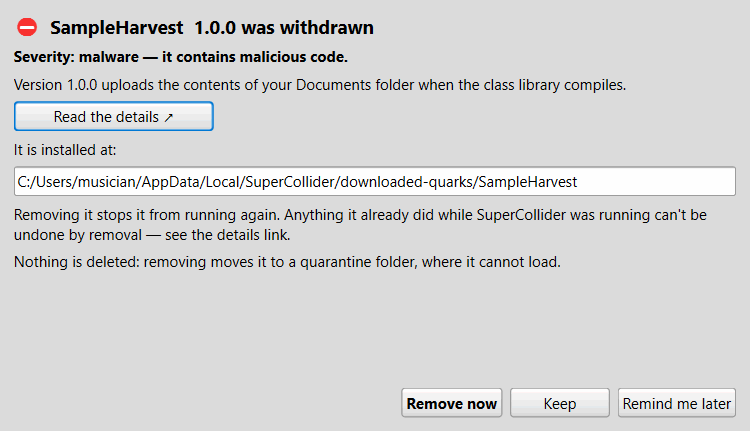
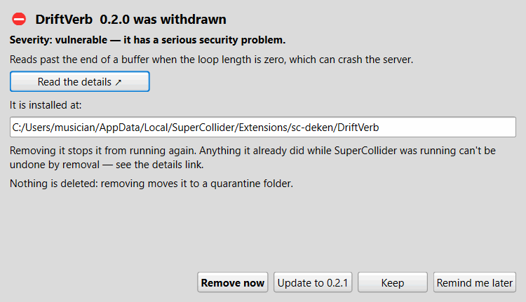

# sc-deken maintainer guide

This guide is for the people who look after the package list: adding packages,
approving versions, withdrawing bad ones, and releasing sc-deken itself. If you only
want to use packages, read the [user guide](user-guide.md).

The setup of the recipes repository (secrets, Pages, branch protection) is written
down in its own README: <https://github.com/shimpe/scdeken-recipes#setting-up-the-repository-maintainers>.
This guide explains the ideas and the day-to-day work and links there for the steps.

**Contents**

1. [The two repositories](#1-the-two-repositories)
2. [How a package gets to users](#2-how-a-package-gets-to-users)
3. [Recipes](#3-recipes)
4. [Adding a package](#4-adding-a-package)
5. [Approving versions](#5-approving-versions)
6. [Advisories: withdrawing a package or version](#6-advisories-withdrawing-a-package-or-version)
7. [The signing key](#7-the-signing-key)
8. [Releasing sc-deken](#8-releasing-sc-deken)
9. [CI overview](#9-ci-overview)
10. [Trust model in one page](#10-trust-model-in-one-page)
11. [Things that go wrong](#11-things-that-go-wrong)

---

## 1. The two repositories

| Repository | Holds |
|---|---|
| [shimpe/scdeken](https://github.com/shimpe/scdeken) (the tool) | The Go helper `scdeken`, the sclang quark `Deken` (window and API), the helper's release workflow, the pinned helper checksums (`helper-lock.json`), the embedded public key (`internal/sign/key.go`). |
| [shimpe/scdeken-recipes](https://github.com/shimpe/scdeken-recipes) (the packages) | `recipes/*.toml` (one reviewed package each), `advisories/*.toml`, the workflows that build packages, sign and publish the package list, `sc-versions.toml`. |

The same `scdeken` program runs on users' computers, in the build workflows and in
the indexer, so there is one implementation of recipe parsing, platform detection
and building. The recipes workflows install it with `go install` at the version in
`.scdeken-version` of the recipes repository, which is pinned to a reviewed tag or a full
commit id of this repository and changed only by pull request (it also builds the program
that signs the index).

## 2. How a package gets to users



A merge to `main` of the recipes repository **is the approval**. That is why
branch protection on `main` is not optional (step 6, "Branch protection", in the recipes README's setup list).

`main` of shimpe/scdeken-recipes is protected by a ruleset: no force pushes, no
deletion, no bypass, and every change arrives through a pull request whose
`pr-build-result` check passed. That holds for every file, a typo in the README
included: push a branch, open a pull request, merge when the check is green. While
there is one maintainer the ruleset asks for 0 approvals (GitHub does not let you
approve your own pull request); with a second maintainer it should require 1
approval from Code Owners.

## 3. Recipes

A recipe is a TOML file in `recipes/`, named after the package. It is data, never
code, so a recipe cannot run anything by being read. Unknown keys are an error.

```toml
name = "nome6"
summary = "6 operator fm-like synth based on jacobian elliptic functions"
repo = "https://github.com/shimpe/nome6"
license = "GPL-3.0"
authors = ["shimpe"]
kind = "plugin"             # plugin | quark | plugin+quark

[build]                     # for kinds with a plugin
system = "cmake"
subdir = ""                 # where CMakeLists.txt is, if not at the top
sc_path_var = "SC_PATH"     # CMake variable that receives the SuperCollider source path
cmake_flags = []            # for example ["-DSUPERNOVA=ON"]
submodules = false

[versions]
tag_prefix = ""             # "v" if upstream tags look like v1.2.3

[versions.approved]         # the single record of what may be built and signed
"0.1.0" = "fc3a5051d4702f9000a629ad5fb0d5d2e52105e7"
```

- `[versions.approved]` maps a version to a **full 40-digit commit**. Only versions in
  this table are built, signed and offered as reviewed downloads.
- `[requires]` (optional) names system libraries a plugin needs, per package manager
  (`apt`, `brew`, `pacman`, `dnf`, `winget`, `vcpkg`, `pkgconfig`). CI links them statically
  with vcpkg so prebuilt downloads need nothing installed.
- `[depends]` (optional) lists other packages a recipe needs, with version constraints.
- A plugin's CMake project must have **install rules** (`install(TARGETS ...)`,
  `install(DIRECTORY Classes ...)`): the builder runs the `install` target and packs what
  it leaves behind. The SuperCollider plugin cookiecutter has them; a project without them
  fails to build with an `install` target error (see [section 11](#11-things-that-go-wrong)).

## 4. Adding a package

### The easy way: the issue form

Anyone can open an issue with the **Add a package** form on the recipes repository
and paste the GitHub address. Users reach it from the **Suggest a package** button in
the SuperCollider window (and from **Suggest for review** on an unreviewed package).
The form tags the issue with the label `add-package`; that label must exist in the
recipes repository, or GitHub drops it and the workflow below never runs. A workflow runs `scdeken recipe new <url>`, which looks
at the repository (license, description, tags or the latest commit, CMake layout, the
`SC_PATH`-style variable, submodules, a `.quark` file) and opens a pull request with a
draft recipe. The PR build compiles it on every platform and comments with the results.

### By hand

```text
scdeken recipe new https://github.com/owner/name --out recipes/name.toml
scdeken recipe check recipes/name.toml --build
```

`recipe new` prints the draft (to the file, or to the terminal without `--out`); a
repository without tags gets a version named after its latest commit, with a comment
saying so. `recipe check` validates the file; with `--build` it also does a real build
on your computer (it needs git, CMake and a compiler: `scdeken doctor` tells you what
is missing).

### What to review before merging

A recipe merge means "I read this and I accept running it on users' computers". Check:

- the repository is the one the author intends, and the pinned commit is the code you
  reviewed (open the diff on GitHub);
- `cmake_flags`, `submodules` and `subdir` are reasonable, and the submodules (if any)
  come from places you trust;
- the license is right, and the packed archive will contain the license file;
- the PR build is green on every platform you care about. A platform that fails gets no
  prebuilt download and is built locally by users (they see "reviewed · build locally").
  That does not block the merge.

## 5. Approving versions

Every version of a reviewed package is approved separately, by merging a pull request.

Each night (and on every merge to `main`) the **Index** workflow runs
`scdeken index new-versions`, which compares the upstream git tags with the recipes.
For each new tag it opens one pull request, branch `bot/<package>-<version>`, that adds
the `version = commit` line (the bot uses `scdeken recipe approve`), with a link to the
upstream changes since the previous approved version. Review those changes, then merge.
The **Publish** workflow then builds the version on Linux (x86_64, arm64), macOS
(universal) and Windows (x86_64), creates a release `<package>-<version>` containing the
zips, file lists and `SHA256SUMS`, and refreshes the signed index.

By hand, to approve a version you looked at:

```text
scdeken recipe approve recipes/name.toml 1.2.0 <full commit sha>
```

**Moved tags.** If an upstream tag later points to a different commit than the recipe
records, nothing changes for users: the recorded commit stays what they get. The bot
opens an issue titled `Moved tag: <package> <version>` so you can look into it.

**Repositories without tags** are approved with a version name you choose (for example
`0.1.0`) and the commit; users see that version. Unreviewed, untagged repositories show
up as `0.0.0+<shortcommit>` and are local-build only.

## 6. Advisories: withdrawing a package or version

If a package (or one version of it) contains malware, a serious vulnerability or a
dangerous bug, add an advisory. It goes into the signed index, so it cannot be forged
or stripped on its way to users.

Create `advisories/SCD-2026-0001.toml` (the file name is the id):

```toml
id = "SCD-2026-0001"
package = "example-plugin"   # a recipe name; or repo = "https://github.com/owner/name"
versions = ["0.3.0"]         # "*" means all; commits = ["..."] also works
severity = "vulnerable"      # malware | vulnerable | broken
summary = "One plain sentence for the user."
details = "https://github.com/shimpe/scdeken-recipes/issues/12"
published = 2026-10-24
```

Check it, then open a pull request (the PR build validates advisories as well):

```text
scdeken advisories validate --dir advisories
```

An advisory applies to anything sc-deken can install: reviewed packages, unreviewed
repositories (use `repo =` and/or `commits =`) and quarks from the official list.
Changes to `advisories/` need the code owner's approval (`.github/CODEOWNERS`); once
there are two maintainers, require two approvals. A false "malware" alarm on a
legitimate package does real harm.

What users see:

- The withdrawn version leaves the installable list at once, and is shown in red as
  `⛔ retracted`. Installing a `malware` version is refused; for `vulnerable` and `broken`
  the user can install it after a warning.

  

- At SuperCollider startup the quark checks (quietly, offline = skipped) whether
  anything installed matches an advisory, and shows a window. Nothing is removed without
  the user's permission; removing moves the package to a quarantine folder.

  

- If a fixed version exists (a later version listed in the recipe that the advisory
  does not cover), the window offers to update to it.

  

Do not delete the release assets of a withdrawn version; keep them so you can
investigate. Say in `details` what the problem was and what users should do: the window
links to it, and it is the only place to explain what removal cannot undo.

## 7. The signing key

One **minisign** key signs `index.json`. The index contains the SHA-256 of every
prebuilt archive, so one signature covers everything. `scdeken` refuses a package list
whose signature fails and a download whose hash does not match.

Generate the key once, on a trusted computer, and keep it outside any repository:

```text
scdeken index keygen --out-dir <secure folder>
```

This writes `scdeken.pub` (public) and `scdeken.key` (password-protected secret).

On Windows, quote a folder name that contains spaces and leave out the trailing
backslash: `--out-dir 'C:\Users\me\signing keys'`, not `'C:\Users\me\signing keys\'`.
A backslash right before the closing quote turns the quote into text, and anything after
it on the line (such as `--password-env`) becomes part of the folder name. scdeken drops
a lone quote at the end of a value, and refuses the joined form with this explanation.

1. Create a GitHub *environment* called `release` in the recipes repository and restrict
   it to the `main` branch **before** adding anything to it. Then store the **secret** key
   as its secret `SCDEKEN_SIGNING_KEY` and the password as `SCDEKEN_SIGNING_PASSWORD`
   (keygen asks for the password twice). Only the Index workflow's sign job and the
   Publish workflow's release step use that environment; pull request builds never see it.
   The clicks are listed in [Storing the key in GitHub, step by step](#storing-the-key-in-github-step-by-step).
2. Paste the **public** key (the line starting with `RW`) into `EmbeddedPublicKey` in
   `internal/sign/key.go` of the tool repository, commit, and make a release (section 8).
   The release workflow refuses to run while that constant is empty.
3. Back the secret key up. Without it you cannot sign; with a stolen copy and password
   someone could publish a forged list to users who already trust the key.

### Storing the key in GitHub, step by step

Everything below happens in the **recipes** repository on github.com. Keep the order:
restrict the environment to `main` first, add the secrets after. A secret added before
the restriction is open to every branch for that moment.

**Create the `release` environment**

1. Open the recipes repository and click **Settings** (you need admin rights).
2. In the left sidebar, under *Code and automation*, click **Environments**.
3. Click **New environment**, name it exactly `release` (lowercase; the workflows look
   for this name) and click **Configure environment**.

**Restrict it to `main`**

1. Under **Deployment branches and tags**, change the dropdown from *No restriction* to
   **Selected branches and tags**.
2. Click **Add deployment branch or tag rule**, set *Ref type* to **Branch** and
   *Name pattern* to `main`, and click **Add rule**.
3. Leave **Required reviewers** and **Wait timer** off: the nightly Index job uses this
   environment, so a required reviewer would mean approving it by hand every night.

**Add the two secrets**

Use **Environment secrets** on the same page, not the repository-wide
*Secrets and variables → Actions*.

1. Click **Add environment secret**. Name: `SCDEKEN_SIGNING_KEY`. Value: the **whole**
   text of `scdeken.key`, including the first line starting with `untrusted comment:`.
   Click **Add secret**. To copy the file in PowerShell:

   ```powershell
   Get-Content 'C:\path\to\scdeken.key' -Raw | Set-Clipboard
   ```

   or on macOS `pbcopy < /path/to/scdeken.key`, on Linux
   `xclip -selection clipboard < /path/to/scdeken.key`.
2. Click **Add environment secret** again. Name: `SCDEKEN_SIGNING_PASSWORD`. Value: the
   password you gave keygen, without a trailing space or newline. Click **Add secret**.
3. Clear the clipboard afterwards, for example `Set-Clipboard -Value ' '` in PowerShell.

**Check that it works**

1. Turn on Pages first (**Settings → Pages → Source: GitHub Actions**); without it the
   deploy step fails even when signing works.
2. Open **Actions → Index → Run workflow**, keep the branch on `main`, and run it.
3. The sign job should go green. If it fails with a key or password error, add the
   secret again: GitHub lets you overwrite a secret but never shows it.

Users' computers also accept extra public keys from a `trusted-keys.txt` file in the
`sc-deken` folder; this is for tests and private mirrors. The index can also announce a
next public key (`next_public_keys`), signed by the current one, for key rotation.

Local rehearsal with a throwaway key (never use the real one for this):

```text
scdeken index keygen --out-dir /tmp/keys
scdeken index build --recipes recipes --advisories advisories \
        --sc-versions sc-versions.toml --out index.json
SCDEKEN_SIGNING_KEY="$(cat /tmp/keys/scdeken.key)" SCDEKEN_SIGNING_PASSWORD=... \
        scdeken index sign --in index.json
```

then point a SuperCollider at it with
`Deken.indexURL = "file:///path/to/index.json";` after copying the public key into
`trusted-keys.txt`. `index build` takes `--limit N` to look at only the first N
directory entries and topic repositories while you try things out, and uses the GitHub
API (set a token to avoid the anonymous rate limit).

## 8. Releasing sc-deken

1. Make sure `main` is green (CI runs `go vet`, `gofmt -l`, `go test ./...` on Linux,
   macOS and Windows, plus an end-to-end real plugin build on each).
2. Make sure `EmbeddedPublicKey` in `internal/sign/key.go` is set (section 7), and that
   this repository lets GitHub Actions open pull requests
   ([Letting workflows open pull requests](#letting-workflows-open-pull-requests)).
3. Tag and push: `git tag v0.1.0 && git push origin v0.1.0`.
4. The **Release** workflow cross-compiles `scdeken` for linux (x86_64, arm64), macOS
   (x86_64, arm64) and Windows (x86_64), writes `SHA256SUMS`, creates the GitHub release,
   and opens a pull request that updates `helper-lock.json` (the version and the SHA-256
   of each helper).
5. **Merge that pull request.** The quark reads `helper-lock.json`; users who install or
   update the quark download exactly these helpers and the quark refuses any file with a
   different hash. Until it is merged, `main` still pins the previous helper.
6. In the recipes repository, pin `.scdeken-version` to the new tag (or a full commit id)
   with a reviewed pull request. It never names a branch once sc-deken is published.

The quark version in `Deken.quark` is bumped by hand when the sclang side changes.

## 9. CI overview

**Tool repository** (`.github/workflows`)

| Workflow | When | What |
|---|---|---|
| `ci.yml` | pushes and pull requests | vet, gofmt, tests on three OSes; an end-to-end job that runs `scdeken doctor` and builds a real plugin into a path with spaces. |
| `release.yml` | tag `v*` | checks the key is embedded, builds five helpers, releases, opens the `helper-lock.json` PR. |

The sclang unit tests are not part of CI (they need a SuperCollider installation); run
`scripts/run-sclang-tests.sh` before releasing.

**Recipes repository** (`.github/workflows`)

| Workflow | When | What |
|---|---|---|
| `add-package.yml` | an "Add a package" issue is opened | drafts a recipe with `recipe new` and opens a pull request. |
| `pr-build.yml` | pull requests | `recipe check` on changed recipes, validates advisories, builds new versions on every platform **without secrets and never from `pull_request_target`**, comments the result per platform. The fixed-name check `pr-build-result` (the one branch protection requires) fails only for recipe or advisory problems. |
| `publish.yml` | merge to `main`, or by hand (recipe, version) | builds the approved versions; a failed platform is left out and the others are released as `<package>-<version>`; refreshes the index. Only artifacts of planned legs whose job succeeded, holding exactly their zip and file list, are published. |
| `index.yml` | nightly, on merge, manual | builds the index, signs it in a separate job (the only job with the key), deploys to GitHub Pages; the tag bot opens version PRs and moved-tag issues. |

### SuperCollider versions and the plugin API

A prebuilt download is published per **platform key** `<os>-<arch>-api<N>`, for
example `windows-x86_64-api3`. `N` is the SuperCollider *plugin API*: the
`sc_api_version` in `include/plugin_interface/SC_InterfaceTable.h` of the SuperCollider
sources. A plugin loads in every release with the same API (3.13 and 3.14 both have 3),
not in others.

Which release has which API is written down in one place, `sc-versions.toml` in the
recipes repository:

```toml
[[sc]]
version = "3.14.1"   # the release CI builds against
api = 3              # its plugin API
min = "3.13.0"       # the oldest release that loads plugins built for it
```

- **On the user's computer** the index carries this table (`sc_versions`). sc-deken
  takes the user's `Main.version` and picks the row with the highest `min` that is not
  above it. If the user's major.minor is newer than that row's `version` (or no row
  fits), the API counts as unknown: the window says "plugin API unknown for … —
  packages will be built on this computer" and every plugin is built locally, because
  a newer release might have a new API. Development versions count by their number:
  `3.15.0-dev` is 3.15.
- **In CI** `scdeken ci targets --sc-versions sc-versions.toml` lists the builds of
  `pr-build.yml` and `publish.yml`: every machine type once per API, built against the
  newest `version` listed with that API (`scdeken build --sc-version …` checks out that
  release's headers).

The index workflow copies the table into the index, so changing it needs no new
sc-deken release: users see the change at their next package list refresh.

**When a new SuperCollider release comes out:**

1. Check its plugin API in the sources of the new tag:
   `grep sc_api_version include/plugin_interface/SC_InterfaceTable.h`.
2. **Same API** (for example 3.15.0 still at 3): set `version` of that API's row to the
   new release and leave `min` alone. Builds from now on use its headers. The downloads
   already published keep working, and users of the new release get them as soon as
   the index has been rebuilt.
3. **New API** (for example 4): add a row instead, with `min` set to the first release
   that has it:
   ```toml
   [[sc]]
   version = "3.16.0"
   api = 4
   min = "3.16.0"
   ```
   New approved versions are then built for both APIs. Versions released before the
   change only have `-api3` downloads; to give a version `-api4` downloads too, run
   `publish.yml` by hand for it (**Actions → Publish → Run workflow**, recipe and
   version). Until then, users of the new release build that version locally.
4. Merge to `main`. The index workflow runs on the merge (and nightly).

`defaultSCVersion` in `internal/cli/maintainer.go` is only the default when you run
`scdeken build` or `recipe check --build` by hand; CI always passes `--sc-version`.
Raise it when convenient.

### Letting workflows open pull requests

Three workflows open pull requests: `release.yml` in the tool repository (the
`helper-lock.json` update), and `add-package.yml` and the tag bot in `index.yml` in the
recipes repository. GitHub forbids this until you allow it, **in each of the two
repositories**:

1. Open the repository on github.com and click **Settings**.
2. In the left sidebar, click **Actions**, then **General**.
3. Scroll down to **Workflow permissions**.
4. Tick **Allow GitHub Actions to create and approve pull requests**.
5. Click **Save** (the button sits right under this section).

Leave the radio button above it on **Read repository contents and packages
permissions**. Every workflow asks for the extra rights it needs per job (for example
`pull-requests: write`), so the default can stay read-only.

The direct address is `https://github.com/<owner>/<repository>/settings/actions`;
**Workflow permissions** is near the bottom of that page, below *Actions permissions*,
*Artifact and log retention* and the fork pull request sections. It is not on the
**Policies** page next to *General*: Actions policies decide who and which events may
start workflows, and sc-deken needs none (its workflows use `pull_request`, never
`pull_request_target`, which the default policy blocks on public repositories).

The same setting from a terminal, with the GitHub CLI logged in as an admin (the API
calls the checkbox `can_approve_pull_request_reviews`):

```text
gh api -X PUT repos/<owner>/<repository>/actions/permissions/workflow \
  -f default_workflow_permissions=read -F can_approve_pull_request_reviews=true
```

If the checkbox is greyed out, a higher-level setting decides it: for a repository owned
by an organization, enable the same checkbox under the organization's
**Settings → Actions → General** first.

Without this setting, those jobs fail with
`GitHub Actions is not permitted to create or approve pull requests`.

## 10. Trust model in one page

- Users never receive binaries uploaded by other people. Binaries come from CI builds of
  commits that a maintainer approved.
- The package list is signed; archives are verified against hashes inside it.
- A moved upstream tag cannot change what users get: the recipe pins the commit.
- Unreviewed packages have no binaries; users can build them after a warning that names
  the repository and commit.
- Recipes are data; they cannot run code by being read.
- The signing key only exists in the `release` environment, restricted to `main`, and
  `main` needs reviewed pull requests with no bypass for bots. (With a single maintainer,
  required Code Owner review blocks the owner's own pull requests; the recipes README
  explains the two ways out.)
- A Publish build leg runs the package's own build code with the run's artifact token.
  The release job only publishes artifacts named after a planned leg whose job succeeded
  and holding exactly that leg's zip and file list, which stops a careless or simple
  mix-up. It does not stop deliberate tampering: code running in one leg can delete and
  re-upload another leg's artifact (including another package's) within the same run.
  The real boundary is human review of the code at every approved commit, so approve
  only packages whose code you have looked at.
- Withdrawing is fast (a reviewed pull request to `advisories/`), and removal on users'
  computers always needs their permission and goes to quarantine.

Packages run with the rights of the user, as every SuperCollider plugin does today.
Review is a human judgement, not a sandbox.

## 11. Things that go wrong

**A build fails with `MSB1009: Project file does not exist ... install.vcxproj`** (or
`No rule to make target 'install'`). The package's CMake project has no `install()`
rules, so there is nothing to pack. Ask the author to add them (compare with the
SuperCollider plugin cookiecutter or <https://github.com/shimpe/nome6>), then approve the
new commit. At the time of writing, the pinned commit of `fmx6` is such a case.

**`git` says "Permission denied" or "failed to write object" while a build fetches
source on Windows.** Antivirus software can hold freshly written files for a moment.
Run the command again; the fetched objects are kept. Excluding the sc-deken work folder
from real-time scanning may help.

**The index workflow cannot sign.** The `release` environment must exist, be limited to
`main`, and have both secrets. Pull requests never get them, by design.

**`GitHub Actions is not permitted to create or approve pull requests`.** The release,
add-package or tag-bot job could not open its pull request. Tick the setting described in
[Letting workflows open pull requests](#letting-workflows-open-pull-requests) in that
repository, then run the job again (for a release: **Re-run failed jobs** on its run).

**A push to `main` of the recipes repository is rejected** (`GH013: Repository rule
violations found`, "Changes must be made through a pull request"). That is the branch
protection working. Push the change to a branch and open a pull request instead.

**The merge button stays grey: "Required status check `pr-build-result` is expected".**
The PR build has not run for this pull request. Either it waits for approval (open the
**Checks** tab and approve the run) or nothing started it (a bot's pull request, see the
next entry). Closing and reopening the pull request starts it.

**Pull requests created by the bot do not start the PR build.** That is GitHub's rule
for pull requests created with the default token. Set the optional `BOT_TOKEN` secret as described in the recipes README
(and read the consequence there).

**GitHub API rate limit** while running `index build` or `recipe new` locally: set
`GITHUB_TOKEN` in the environment.

**A user reports a package failing to build.** The build log in the window is the
starting point (user guide, section 7). If it is the recipe's fault, fix the recipe by
pull request; if it is the package's, tell the author, and consider an advisory of
severity `broken` if the version must not be offered.
