# sc-deken user guide

This guide is for people who make music with SuperCollider and want to use
plugins and quarks that other people wrote. You do not need to know what a
compiler is.

**Contents**

1. [What sc-deken does](#1-what-sc-deken-does)
2. [Install sc-deken](#2-install-sc-deken)
3. [The window](#3-the-window)
4. [Find a package](#4-find-a-package)
5. [What the labels mean](#5-what-the-labels-mean)
6. [Install a package](#6-install-a-package)
7. [When a package has to be built on your computer](#7-when-a-package-has-to-be-built-on-your-computer)
8. [Unreviewed packages](#8-unreviewed-packages)
9. [A copy is already on your computer](#9-a-copy-is-already-on-your-computer)
10. [Update and remove](#10-update-and-remove)
11. [Withdrawn packages](#11-withdrawn-packages)
12. [Settings](#12-settings)
13. [Using sc-deken from code](#13-using-sc-deken-from-code)
14. [Troubleshooting](#14-troubleshooting)

The pictures were taken on Windows 11 with SuperCollider 3.14.1. On macOS and Linux
the window looks the same apart from the fonts and title bars. The package list in
the pictures is a test list, so versions and stars are only examples.

---

## 1. What sc-deken does

There are two kinds of add-ons for SuperCollider:

- **Plugins** (also called UGens) are small programs that make the sound server
  do something new, such as a new oscillator or filter. Most are published as
  source code and have to be *compiled* before SuperCollider can use them.
- **Quarks** are collections of SuperCollider code (classes and help files).
  SuperCollider can install them itself.

sc-deken gives you one window for both. It keeps a searchable list of packages.
For many plugins there is a ready-made download for your computer, made by an
automatic build and checked before it reaches you. When there is none, sc-deken
builds the plugin on your computer and tells you exactly which tools are
missing, if any.

## 2. Install sc-deken

Open SuperCollider and run these two lines (select them and press Ctrl+Enter,
or Cmd+Enter on a Mac):

```supercollider
Quarks.install("https://github.com/shimpe/scdeken");
thisProcess.recompile;
```

SuperCollider restarts its class library. Then open the window:

```supercollider
Deken.gui;
```

The first time, sc-deken downloads its small helper program (`scdeken`) and
checks it against a checksum that came with the quark. The window opens at once;
the package list appears when the helper is ready. You need SuperCollider 3.13
or newer, and an internet connection for the first start.

## 3. The window


- **Left**: the pages. *Browse* lists all packages. *Installed (n)* lists what is on
  your computer. *Updates (n)* lists installed packages that have a newer version.
  *Build log* shows what sc-deken is doing while it works. *Settings*.
- **Middle**: a search box, filter buttons (*All*, *Plugins*, *Quarks*, *Plugin + Quark*)
  and the list. Every row has the type, the name, a one-line summary and a status.
- **Right**: details of the selected package: what is inside, what you have to do
  afterwards, which version you get, and the buttons.
- **Bottom**: what sc-deken knows about your computer, for example
  "Windows x86_64 - plugin API 3 - scsynth+supernova". Prebuilt plugins are chosen by this.

Nothing in the window makes SuperCollider wait. While a package is being installed
its row says "working…" and its buttons are off; you can keep browsing.

## 4. Find a package

Type in the search box. sc-deken looks at the package name, the summary and the
names of the UGens and classes inside the package, so you can search for a
sound you have heard of ("fm", "reverb") or for a UGen name from someone's code.


Here `fm` finds fmx6 and nome6 by name and summary, and sc3-plugins because it
contains the UGen `FM7` (the note in front of its summary says so, so a long summary
never hides it).

Use the filter buttons to show only plugins, only quarks, or only packages that are
both. By default the list shows reviewed and community-listed packages. To include
automatically discovered, not yet reviewed packages tick **Show unreviewed**
(see [section 8](#8-unreviewed-packages)).

### Missing a package?

Click **Suggest a package** at the right end of the filter buttons. It opens the
"Add a package" form on GitHub, where you paste the address of the plugin or quark
(for example `https://github.com/someone/their-plugin`). If you pasted that address
into the search box first, the form already has it. You need a GitHub account to send
the form. You can also open the form directly:
<https://github.com/shimpe/scdeken-recipes/issues/new?template=add-package.yml>.

The maintainers get a pull request with a draft recipe and a build on every platform;
once they have reviewed and merged it, the package shows up for everyone the next day.

If you wrote the package yourself, you can also add the GitHub topic
`supercollider-plugin` or `supercollider-quark` to your repository. sc-deken then finds
it on its own (the next day) and lists it as unreviewed.

## 5. What the labels mean

**Type** (the coloured box at the start of a row, repeated at the top of the
details pane):

| Type | Meaning |
|---|---|
| `PLUGIN` | A compiled plugin for the sound server, with the small class files that let you use it in code. |
| `QUARK` | SuperCollider code only (classes, help). Nothing is compiled. |
| `PLUGIN + QUARK` | A compiled plugin plus a larger library of SuperCollider code (none of the pictures here shows one). |

**Status** (the last column):

| Status | Meaning |
|---|---|
| `reviewed · prebuilt` | A maintainer reviewed this exact version, and there is a ready-made download for your computer. |
| `reviewed · build locally` | Reviewed, but no download for your computer: sc-deken builds it here. |
| `reviewed` | Reviewed. This is all a row says until you select it; the details pane then adds how it will be installed. |
| `community-listed` | A quark from SuperCollider's official quarks list. |
| `⚠ unreviewed · build locally` (plugins) or `⚠ unreviewed` (quarks) | Found automatically. Nobody has looked at it. See [section 8](#8-unreviewed-packages). |
| `update available` | You have it, and a newer version exists. |
| `installed` | You have it, and sc-deken has no further information about it (for example a copy you put there by hand). |
| `⛔ retracted` (red) | Withdrawn because of malware, a serious problem or a dangerous bug. See [section 11](#11-withdrawn-packages). |
| `working…` | An install, update or removal is running. |

A package you have installed does not get its own badge in *Browse*; select it and the
details pane offers **Remove** instead of **Install**, or look on the *Installed* page.

## 6. Install a package

Select a package and press **Install**. For a reviewed plugin with a prebuilt
download this takes a moment: the file is downloaded, checked against the signed
package list and unpacked into the sc-deken folder inside your SuperCollider
extensions folder.

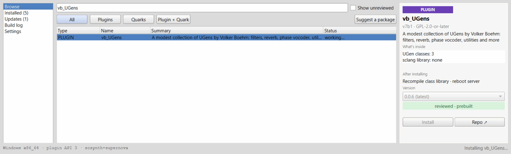

When it is done a window tells you what to do next:

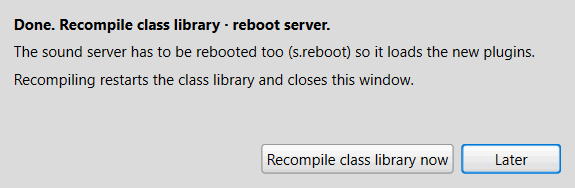

- **Recompile the class library** (Language > Recompile Class Library, or press
  the button) so SuperCollider sees the new classes and help. Do this after every
  install of anything that has classes, which is almost everything.
- **Reboot the sound server** (`s.reboot`) after installing a plugin, so the server
  loads the new UGens.

The package is now listed under *Installed*, and its button changes to **Remove**.

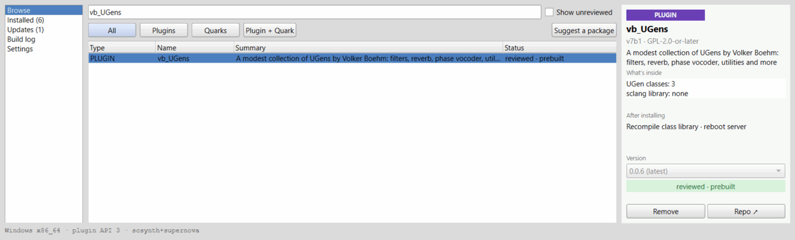

**Quarks** are installed through SuperCollider's own Quarks system, pinned to the commit the reviewers approved; they
show up in the Quarks window too.

**Needs.** Some quarks need other quarks. The details pane lists them, and
sc-deken installs them first.


**Versions.** The *Version* box lists the versions that are available. The newest
is chosen. Pick an older one if you need it.

## 7. When a package has to be built on your computer

Some plugins have no ready-made download for your computer. The status says
`reviewed · build locally` and the pane explains why.


Building needs three tools that are not part of SuperCollider:

- **Git** (to fetch the source code),
- **CMake** (to prepare the build),
- a **C++ compiler** (on Windows the "Build Tools for Visual Studio" with the C++
  workload; on macOS the Xcode command line tools; on Linux `g++` or `clang++`).

Before it builds, sc-deken checks that you have them. If something is missing it
stops and says what, with the command that installs it:


Copy the command (the **Copy** button), run it in a terminal, then press
**Check again**. When nothing is missing the button changes to continue. You only
have to do this once per tool.

The first build also downloads the SuperCollider source that matches your version
(one time; it is kept for later builds). This needs git and an internet connection and
can take a few minutes. Building a small plugin takes a minute or two.

On Windows, packages that need extra system libraries may fail to link when built here
(for example sc3-plugins needs FFTW, which a plain Windows computer does not have). Use
the prebuilt download on Windows: if a package only offers a local build, wait until the
reviewers have published a prebuilt version.

Everything the build prints goes to the **Build log** page, so you can see what is
happening or copy the text if you need to ask for help:

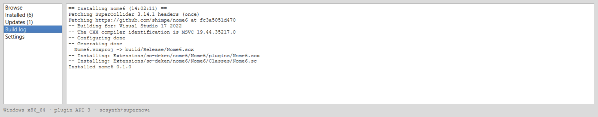

## 8. Unreviewed packages

Besides the reviewed packages, sc-deken knows about packages it discovered
automatically (for example by their GitHub topics). Nobody has looked at their
code. They are hidden until you tick **Show unreviewed**.

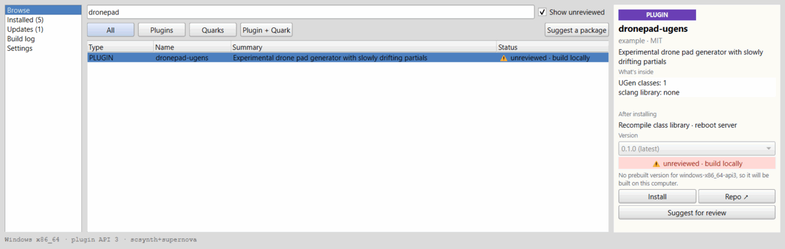

They have no prebuilt downloads, so installing one means building the code on your
computer. Before that, sc-deken asks you to confirm, and says where the code comes
from and which exact version of it will be used:


A plugin runs with all your rights, like any program. Only go on if you trust the
author. **Cancel** is the default button, and nothing has been installed before you
agree. **Suggest for review** opens a form where you can ask the maintainers to review
a package.

## 9. A copy is already on your computer

If you put a plugin into your extensions folder by hand earlier, a second copy would
cause "duplicate class" errors. sc-deken looks for existing copies and asks:

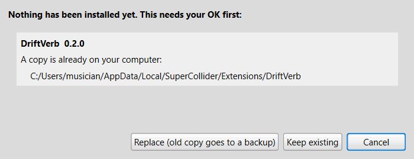

- **Replace** moves the old copy to a backup folder (it is never deleted, and its files
  are renamed so they can't load from there) and installs the new one.
- **Keep existing** stops, and leaves your copy as it is.

## 10. Update and remove

The *Installed* page lists everything on your computer, including quarks you
installed the old way:


A package with a newer version is marked `update available` and also appears on
the *Updates* page:

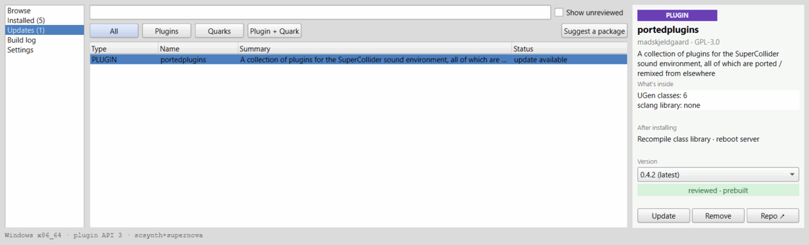

Press **Update** to install the newest version. The old version stays in place until
the new one is ready, and comes back if the update fails. A quark is moved to the new
version with SuperCollider's own Quarks system.

Press **Remove** to take a package off your computer. You are asked first:

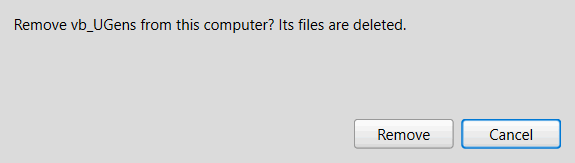

Removal deletes the plugin's folder (or uninstalls the quark). It does not touch
files you put somewhere else yourself.

## 11. Withdrawn packages

Sometimes a package turns out to be a problem: it contains malware, a serious security
hole, or a bug that can crash your computer or lose your work. The maintainers can
**withdraw** it, which means:

- It is shown in red as `⛔ retracted`, and the Install button is off for the withdrawn
  version.

  

- For **malware** the install is refused. For a serious vulnerability or a dangerous bug
  you can still install the version after a warning that explains the problem.

  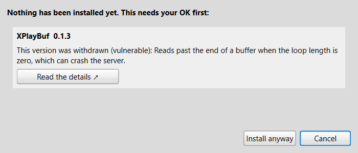

- When you start SuperCollider, sc-deken quietly checks whether anything you have
  installed was withdrawn. If so, a window tells you which package, why, and where it
  is on your computer. Offline, the check uses the saved, signed package list (and
  says nothing if there is none yet).

  

You decide what happens. **Nothing is removed without your permission.**

- **Remove now** (recommended for malware and serious vulnerabilities) moves the
  package to a *quarantine* folder outside the places SuperCollider loads from, and
  renames its `.sc`, `.scx` and `.so` files to end in `.disabled`, so it can't load
  even if a setting of yours points SuperCollider there. Nothing is deleted, so a false
  alarm costs you nothing. Afterwards you are asked to
  recompile the class library (and reboot the server for plugins).

  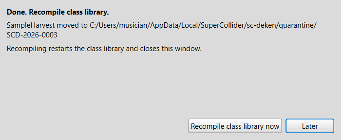

- **Update to x.y.z** appears when a fixed version exists:

  

- **Keep** leaves the package alone and remembers your choice so you are not asked at
  every start. For malware you are asked a second time. A kept package is still marked
  `⛔ retracted` in the lists.

  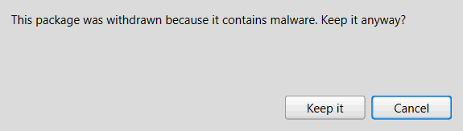

- **Remind me later** does nothing now and asks again next time.

Be aware: removing malware stops it from running again, but it cannot undo what it
already did while SuperCollider was running. The "details" link in the window says what
the problem was.

Quarantined packages stay on disk until you delete them yourself in *Settings*.

## 12. Settings

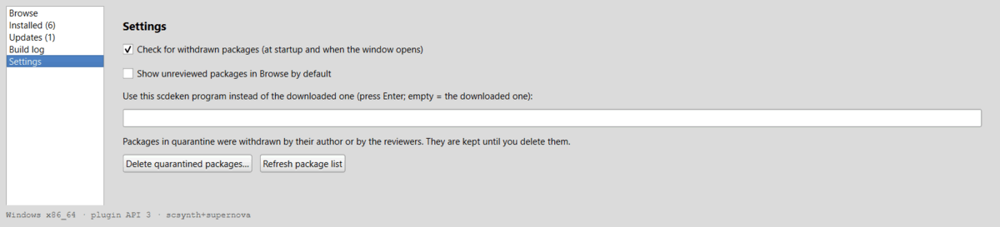

- **Check for withdrawn packages (at startup and when the window opens)** (on by
  default). Turn it off if you never want sc-deken to look, neither when
  SuperCollider starts nor when the window opens.
- **Show unreviewed packages in Browse by default** (off by default).
- **Use this scdeken program instead of the downloaded one**: for developers. Leave it
  empty.
- **Delete quarantined packages...** removes packages that were put in quarantine, for
  good, after asking.
- **Refresh package list** downloads the list again. sc-deken does this by itself
  at most once an hour.

The settings are kept in the `sc-deken` folder inside SuperCollider's user folder
(`Platform.userAppSupportDir`).

## 13. Using sc-deken from code

Everything in the window can be done from code. Calls return at once; the result is
posted when it is ready.

```supercollider
Deken.search("fm");              // list matching packages
Deken.info(\Panola);             // versions, trust, withdrawn versions
Deken.install(\Panola);          // a quark
Deken.install(\portedplugins);   // a plugin
Deken.install(\portedplugins, "0.4.1");   // a specific version
Deken.update(\portedplugins);
Deken.update;                    // every package that has an update
Deken.remove(\portedplugins);
Deken.list;                      // what is installed
Deken.doctor;                    // are the build tools there?
```

If an install needs your OK (unreviewed, withdrawn, existing copy) nothing is
installed, and the posted message shows the exact `Deken.installConfirmed` call (for
`Deken.update` without a name: `Deken.updateConfirmed`) to make if you agree. If the
package list changes between your OK and the install, sc-deken says so and asks again.
See the help page `Deken` for all methods.

## 14. Troubleshooting

**"Can't update/remove X while SuperCollider is using it. Quit the server
(s.quit) and try again."** (Windows)
Windows will not let a program replace a plugin file that the sound server has loaded.
Run `s.quit`, repeat the update or removal, then `s.boot` again.

**Nothing happens after installing a plugin / the UGen is not found.**
Recompile the class library (Language > Recompile Class Library), and reboot the
server (`s.reboot`). The window reminds you after each install; both are needed.

**"No package list yet; connect to the internet once so sc-deken can download it."**
The list has never been downloaded on this computer. Connect, then press
*Refresh package list* in Settings.

**Working offline.** After the list has been downloaded once, search and browsing use
the saved, signed copy, so they work without internet, and so does the check for
withdrawn packages (it checks against that saved copy). Installing a prebuilt plugin and
building from source need a connection. If the server cannot be reached, sc-deken says
"Using the package list from <date>" in the Build log and carries on with the saved copy.

**The package list could not be verified.** sc-deken refuses a list whose signature
does not match, and keeps using the last good copy. If it persists, update sc-deken
(`Quarks.update("scdeken");` and recompile; the quark is named after its address,
`https://github.com/shimpe/scdeken`).

**"Some tools are missing" for a local build.** Install what the dialog names, press
*Check again*. If a tool is installed but not found, restart SuperCollider so it picks up
the updated PATH.

**A build fails.** Open the Build log page and read the last lines. Often a plugin does
not support your SuperCollider or compiler version. The failure window has a **Report this
problem** button: it opens a GitHub issue for the reviewers, already filled in with the
package, your platform, your SuperCollider version and the last lines of the log (read it
before you send it). You can also copy the log when you ask the package's author for help,
and mention your platform line from the bottom of the window.

**"plugin API unknown for 3.15.0 — packages will be built on this computer"** (at the
bottom of the window). A compiled plugin only loads in SuperCollider releases with the
same *plugin API* (the interface between scsynth and its plugins; 3.13 and 3.14 both
use API 3). sc-deken learns which release has which API from the package list. Your
SuperCollider is newer than any release the list knows about, so it can't be sure that
the prebuilt downloads would load, and builds every plugin on your computer instead
(see section 7). Quarks are not affected. Once the maintainers add your release, the
prebuilt downloads come back by themselves the next time the package list is refreshed.

**"…from before the first sc-deken release, so there is no helper to download yet"** or
**"sc-deken x.y.z has no helper for this computer"**. The quark downloads its helper
program (`scdeken`) from a GitHub release and checks it against the checksum listed in the
quark. Before the first release, or on a computer the release has no build for, there is
nothing it could check, so it downloads nothing. Update the quark once a release is out
(`Quarks.update("scdeken");` and recompile). Or build `scdeken` yourself
(`go build -o scdeken ./cmd/scdeken` in the sc-deken repository; Go is needed), enter its
path on the Settings page of the window, and open the window again.

**The helper download stops with "took too long".** sc-deken gives up on a download that
cannot connect within 30 seconds or takes more than 10 minutes. Check your connection and
try again.

**The helper cannot be downloaded or fails its checksum.** sc-deken will not run a helper
it could not verify. Check your internet connection and any firewall, then try again.

**Antivirus software gets in the way** (for example Norton on Windows). It can hold or
quarantine a freshly downloaded `scdeken` helper (a new program it has never seen), or
block git for a moment while it writes files, which shows up as `Permission denied` or
`failed to write object` in the Build log. Simply try again; the files already fetched are
kept. If it keeps happening, tell your antivirus to allow the folders SuperCollider keeps
its sc-deken files in: the `sc-deken` folder inside `Platform.userAppSupportDir` and the
`sc-deken` folder inside `Platform.userExtensionDir` (evaluate both in SuperCollider to see
where they are). Only do this for folders you recognise.

**I want my old copy back after "Replace".** The old copy is in the `backup` folder inside
`Platform.userAppSupportDir +/+ "sc-deken"`, in a subfolder named after the date and time.
So that it can't load from there by accident, its `.sc`, `.scx` and `.so` files were
renamed to end in `.disabled` (`FMX6.scx` became `FMX6.scx.disabled`). Remove the package
installed by sc-deken first, then move the folder back where it was, take `.disabled` off
those file names, recompile and reboot the server. The same goes for a package you take
back out of quarantine.

**"Nothing was moved: the backup (or quarantine) folder … is inside …"** sc-deken keeps
replaced and withdrawn copies in `Platform.userAppSupportDir +/+ "sc-deken"`, a folder
SuperCollider normally does not load from. On your computer one of the folders it does
load from contains it: an include path in `LanguageConfig` (for example your home
folder), or a changed `Platform.userExtensionDir` or `Platform.systemExtensionDir`. The
message names which. A copy moved there would load again, so sc-deken refuses. Change
that setting so it no longer contains the sc-deken folder (add the specific folders you
need as include paths instead), recompile, and try again.

**Where are my files?** Plugins installed by sc-deken are in
`Platform.userExtensionDir/sc-deken/<package>`. Evaluate `Platform.userExtensionDir` to see
the folder. Quarks are in SuperCollider's usual quarks folder.

If you find a problem with sc-deken itself, please open an issue at
<https://github.com/shimpe/scdeken/issues>.
